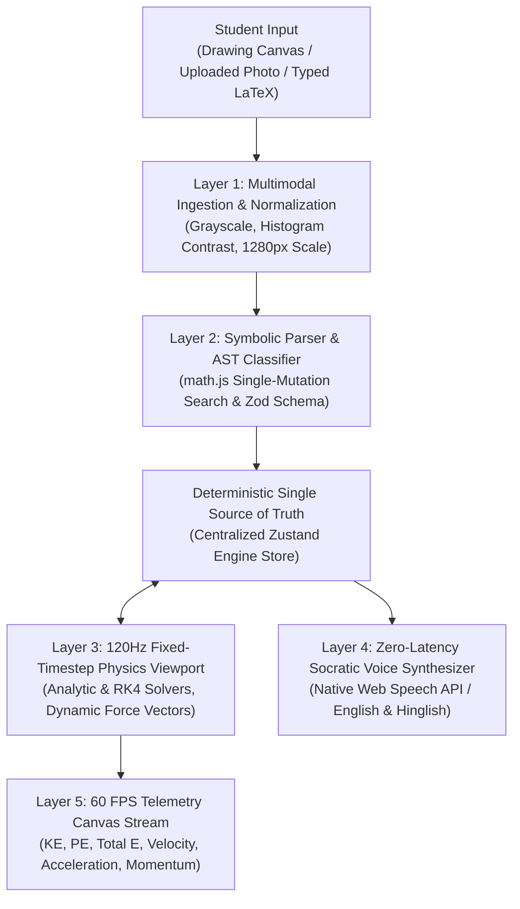

# ⚛️ Axiom Engine

> **"Write the math. Watch the physics. Catch the bug."**
>
> A deterministic physics learning engine where handwritten derivations are parsed into LaTeX, verified step-by-step by an AST math engine, and connected live to a 60 FPS interactive physics simulation.

[](https://nextjs.org/)
[](https://www.typescriptlang.org/)
[](https://tailwindcss.com/)
[](https://vitest.dev/)
[]()
[](https://github.com/priya-kumaricodes/axiom-engine/graphs/contributors)

---

## ⚡ Super Easy Quick Start (3 Steps)

You do **NOT** need any API keys, logins, or credit cards. The entire app runs **100% offline out-of-the-box**.

```bash
# 1. Clone the repository
git clone https://github.com/priya-kumaricodes/axiom-engine.git

# 2. Enter directory and install packages
cd axiom-engine
npm install

# 3. Start the local server
npm run dev
```

Now open **[http://localhost:3000](http://localhost:3000)** in your browser!

---

## 🎮 How to Use Axiom Engine (In 3 Minutes)

```
       [ 1. WRITE OR DRAW ]               [ 2. VERIFY STEPS ]              [ 3. WATCH SIMULATION ]
   ┌───────────────────────────┐      ┌─────────────────────────┐      ┌─────────────────────────┐
   │ Draw on digital canvas    │  ──► │ math.js checks AST for: │  ──► │ Real-time 60FPS physics │
   │ Upload notebook photo     │      │ - Trig component bugs   │      │ Forces, vectors, graphs │
   │ Or type LaTeX equations   │      │ - Sign / dimension bugs │      │ Two-way parameter sync  │
   └───────────────────────────┘      └─────────────────────────┘      └─────────────────────────┘
```

1. **Open the Lab**: Click **"OPEN THE LAB"** on the home page or navigate to `/workspace`.
2. **Try the 4 Built-In Presets**:
   - `[1] Incline Friction Bug`: A block sliding down a ramp with a deliberate $\sin\theta \leftrightarrow \cos\theta$ component mistake.
   - `[2] Pulley-Block Bug`: An Atwood system with a denominator sign flip error.
   - `[3] Projectile Collision`: Two colliding particles with component swapping.
   - `[4] SHM Energy Damping`: A damped harmonic oscillator with an inverted ratio dimensional error.
3. **Test with Your Own Math**:
   - **DRAW**: Use your mouse or stylus to write equations on the notebook canvas.
   - **UPLOAD**: Drop a photo of your handwritten rough notebook page.
   - **TYPE**: Paste or type derivation lines like `N = m * g * sin(theta)`.
4. **Click "ANALYZE WORK"**:
   - The engine checks every single line.
   - If there is a mistake, you get a **Socratic Hint** in English or Hinglish without spoiling the solution!
   - Click **"SHOW ME WHY"** or **"REVEAL CORRECT STEP"** when you are ready.
5. **Two-Way Live Sync**:
   - Drag the ramp angle in the simulation viewport $\to$ Equations recalculate in real time!
   - Scrub the mass or friction slider in the bottom deck $\to$ Force vectors double or halve live!

---

## 💡 What Makes Axiom Engine Different?

| Common Educational AI Tools | The Axiom Engine Way |
| :--- | :--- |
| ❌ Hallucinates math calculations and fabricated numbers | ✅ **Deterministic single source of truth**: symbolic `math.js` + dimensional analysis |
| ❌ Spoils the final answer instantly without teaching intuition | ✅ **Socratic hints** that guide the student to discover the mistake themselves |
| ❌ Static text-only responses | ✅ **Live 60 FPS physics simulation** with dynamic force vectors |
| ❌ Disconnected from real formulas | ✅ **Two-way live synchronization**: math and simulation control each other |
| ❌ Requires paid cloud API keys | ✅ **Runs 100% offline** with zero latency |

---

## 👥 Co-Creators & Contributions

Axiom Engine was architected and built from scratch as a joint collaboration by **Priya Kumari** and **Anurag Tiwari**:

```
                                  ┌───────────────────────────────┐
                                  │         AXIOM ENGINE          │
                                  │   Co-Created & Developed By   │
                                  └──────────────┬────────────────┘
                                                 │
                        ┌────────────────────────┴────────────────────────┐
                        │                                                 │
          ┌─────────────▼─────────────┐                     ┌─────────────▼─────────────┐
          │       PRIYA KUMARI        │                     │       ANURAG TIWARI       │
          │  Frontend & UI/UX Lead    │                     │   Core Engine & Math Lead │
          └───────────────────────────┘                     └───────────────────────────┘
```

### 👩‍💻 Priya Kumari — *Frontend Architecture & Creative UI/UX Lead*
- **Portfolio & Code**: [github.com/priya-kumaricodes](https://github.com/priya-kumaricodes)
- **LinkedIn**: [linkedin.com/in/priya-kumari-411706444](https://www.linkedin.com/in/priya-kumari-411706444/)
- **Email**: [priya06.18kumari@gmail.com](mailto:priya06.18kumari@gmail.com)
- **Key Contributions**:
  - Designed the award-winning **Neo-Brutalist & Buttermax tactile hardware UI** across the entire application.
  - Engineered the global **Buttermax.net-style liquid metaball blob cursor** with SVG gooey filtering and `mix-blend-mode: difference` text inversion.
  - Built the centralized **Zustand two-way state synchronization** connecting algebraic cards with the viewport.
  - Integrated the zero-latency **Socratic voice tutor** using the native browser Web Speech API.
  - Designed the **60 FPS audio-phys studio EQ visualizer** and responsive 3-column lab workstation.

---

### 👨‍💻 Anurag Tiwari — *Core Mathematical & Physics Engine Lead*
- **Portfolio & Code**: [github.com/Anurag-tiwaricodes](https://github.com/Anurag-tiwaricodes)
- **LinkedIn**: [linkedin.com/in/anurag-tiwari-2b1913427](https://www.linkedin.com/in/anurag-tiwari-2b1913427/)
- **Instagram**: [instagram.com/anurag.tiwari1805](https://www.instagram.com/anurag.tiwari1805/)
- **Email**: [anurag18.05tiwari@gmail.com](mailto:anurag18.05tiwari@gmail.com)
- **Key Contributions**:
  - Engineered the deterministic **symbolic math verification engine** and line-by-line AST parser using `math.js`.
  - Built physical **dimensional analysis, unit validation**, and single-mutation error classification (`ERROR_TRIG`, `ERROR_SIGN`, `ERROR_DIMENSION`).
  - Authored the **120 Hz fixed-timestep physics solvers** (analytic incline, Atwood machine, and Runge-Kutta 4th order harmonic oscillator).
  - Implemented the **Gemini Vision multimodal OCR pipeline** with schema sanitization and offline fallback.
  - Built the automated **17-check Vitest verification protocol** ensuring zero mathematical drift.

---

## 🏛️ System Architecture



---

## 📦 The 4 Physical Scenarios

| Scenario | Domain | Verified Output | Planted Diagnostic Bug |
| :--- | :--- | :--- | :--- |
| **P1: Block on Incline** | `incline` | $N = 42.48\text{ N}$, $f = 10.62\text{ N}$, $a = 2.781\text{ m/s}^2$ | **Trig Error:** Used $\sin\theta$ instead of $\cos\theta$ for normal force. |
| **P2: Atwood Pulley** | `atwood` | $a = 2.4525\text{ m/s}^2$, $T = 22.0725\text{ N}$ | **Sign Error:** Denominator sign flip $(m_1 - m_2)$ instead of $(m_1 + m_2)$. |
| **P3: Projectile Target** | `projectile_collision` | Collide at $t = 2.0\text{ s}$, $y = 12.38\text{ m}$ | **Component Swap:** Used vertical velocity for horizontal flight time. |
| **P4: Damped SHM** | `shm` | $\omega_0 = 5.0\text{ rad/s}$, $E(2\text{s}) \approx 1.395\text{ J}$ | **Dimensional Mismatch:** Inverted ratio $\sqrt{m/k}$ gives time $[T]$ instead of $[T^{-1}]$. |

---

## 🧪 Testing & Verification (17/17 Checks Passed)

Run the automated test suite covering all mathematical, numerical, and symbolic routines:

```bash
# Run unit tests
npm test

# Run full quality check (lint + typecheck + test + production build)
npm run verify
```

Every single check passes with 0 errors:
- ✅ Analytical derived physics solutions match theoretical benchmarks ($\pm 0.01$).
- ✅ Mass doubling maintains invariant acceleration ($m$ cancels out).
- ✅ Numerical Runge-Kutta 4th-order (RK4) integration satisfies energy conservation laws.
- ✅ Symbolic single-mutation search flags trigonometric, algebraic, and sign errors.
- ✅ Dimensional analysis rejects illegal additions like $m + a$ and functions like $\sin(m)$.
- ✅ Zod schema rejects malformed inputs and guarantees runtime contracts.

---

## ⌨️ Keyboard Shortcuts

| Key | Action |
| :--- | :--- |
| `Space` | Toggle simulation Play / Pause |
| `R` | Reset simulation to initial state |
| `V` | Toggle Free Body Diagram (FBD) force vectors |
| `1` | Load Incline Friction Bug preset |
| `2` | Load Pulley-Block Bug preset |
| `3` | Load Projectile Collision preset |
| `4` | Load SHM Energy Damping preset |
| `?` | Open / Close Keyboard Shortcuts modal |
| `Esc` | Close open modals |

---

## 📄 License

This project is licensed under the [MIT License](LICENSE).

## Requirements

- Node.js `>=20`
- npm (lockfile: package-lock.json)
- A local `.env` created from `.env.example`
